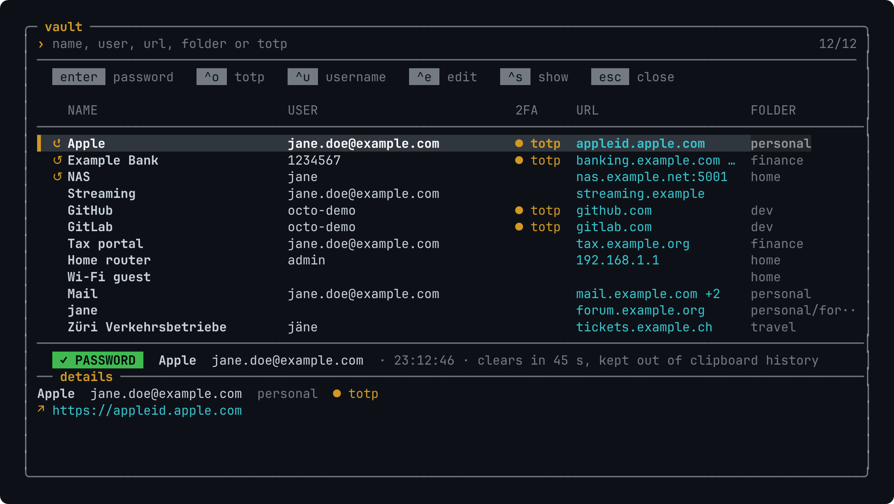
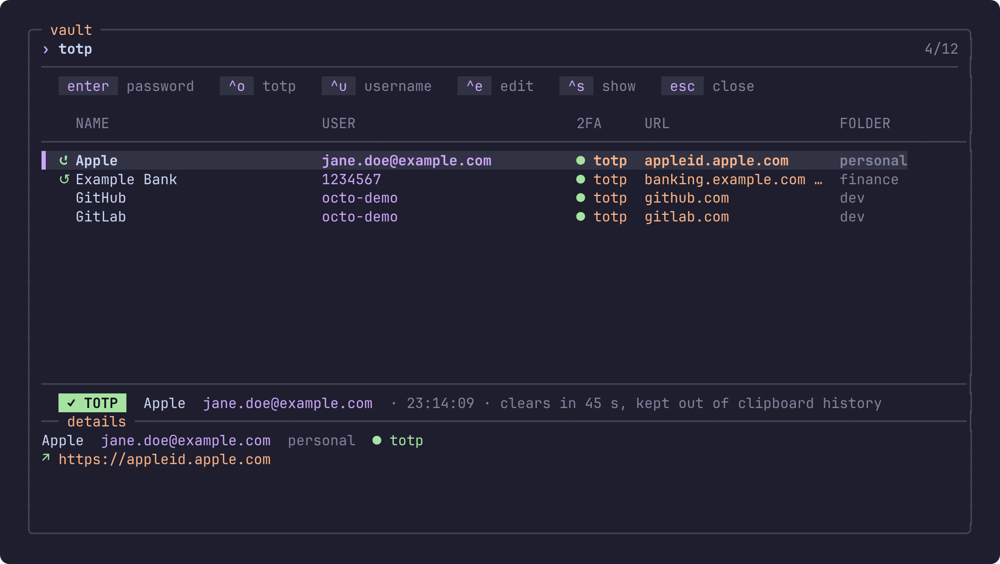

# vaultpick

Pick an entry from your [Bitwarden](https://bitwarden.com) or
[Vaultwarden](https://github.com/dani-garcia/vaultwarden) vault in the
terminal and copy what you need: password, username or TOTP code.



vaultpick is a single POSIX shell script on top of
[rbw](https://github.com/doy/rbw), [fzf](https://github.com/junegunn/fzf) and
[jq](https://jqlang.org).

- **The list stays open after copying.** Username, password and TOTP code go
  one after another, without searching again.
- **Recently used entries come first.** Type a query and the whole vault is
  searched.
- **Nothing secret on screen.** The status line says what was copied from
  which entry, never the value. The preview shows names and URLs only.
- **The clipboard is cleared** after 45 seconds, if it still holds the value.
  Under Wayland the value is also kept out of the clipboard history.
- **Search by anything you see:** name, username, URL, folder, or `totp` for
  every entry with a second factor.

## Requirements

- [rbw](https://github.com/doy/rbw), set up and logged in (`rbw login`)
- [fzf](https://github.com/junegunn/fzf) 0.63 or newer. Distribution packages
  are often older; vaultpick tells you if yours is.
- [jq](https://jqlang.org)

## Install

vaultpick is one file. Put it anywhere on your `PATH`:

```sh
git clone https://github.com/grafdon/vaultpick
cd vaultpick
make install            # installs to ~/.local/bin; set PREFIX to change that
```

If you would rather type less: `alias pw=vaultpick`.

## Usage

```sh
vaultpick [query]      # copy the password
vaultpick -o [query]   # copy the TOTP code
vaultpick -u [query]   # copy the username
vaultpick -e [query]   # edit the entry
vaultpick -s [query]   # print the whole entry, including the password
```

The option only decides what Enter does. Every action is also on a key:

| Key      | Action                              |
| -------- | ----------------------------------- |
| `enter`  | the chosen action (default: copy the password) |
| `ctrl-o` | copy the TOTP code                  |
| `ctrl-u` | copy the username                   |
| `ctrl-e` | edit the entry (`rbw edit`)         |
| `ctrl-s` | print the whole entry               |
| `esc`    | close                               |

Entries you used recently are listed first and marked with `↺`. The columns
are name, username, 2FA, URL (the host of the first URL; `+2` means two more)
and folder. They follow the width of the terminal; what does not fit is cut
off on screen but can still be searched.

## Configuration

Everything is set through environment variables.

| Variable                | Default | Meaning |
| ----------------------- | ------- | ------- |
| `VAULTPICK_THEME`       | `ansi`  | `ansi` uses your terminal's 16 colours and works everywhere. `amber` and `mocha` (Catppuccin Mocha) need a terminal with 24-bit colour. [`NO_COLOR`](https://no-color.org) turns colour off. |
| `VAULTPICK_RECENT`      | `10`    | How many recently used entries are listed first. `0` turns the history off. |
| `VAULTPICK_CLEAR`       | `45`    | Seconds until the clipboard is cleared. `0` never clears. |
| `VAULTPICK_CLIPBOARD`   | `auto`  | Force a clipboard tool: `wayland`, `xclip`, `xsel`, `macos`, `termux`, `wsl` or `rbw`. |
| `VAULTPICK_ASCII`       | from the locale | `1` uses ASCII only, for terminals or fonts without Unicode. |
| `VAULTPICK_PASS_LAYOUT` | `0`     | `1` is for vaults imported from `pass` or `gopass`, where the folder is the site and the entry is the username (`logins/example.com/jane`): the folder is then shown as the name. |

The `mocha` theme, searching for every entry with a TOTP code:



## Platforms

vaultpick runs wherever rbw runs. The clipboard is the part that differs:

| System | Clipboard tool | Clears after timeout | Status |
| ------ | -------------- | -------------------- | ------ |
| Linux, Wayland | `wl-copy` (wl-clipboard) | yes, and hidden from the clipboard history | used daily |
| macOS | `pbcopy` | yes | automated tests |
| Linux and BSD, X11 | `xclip` or `xsel` | yes | automated tests with a stand-in, reports welcome |
| Android, Termux | `termux-clipboard-set` | yes | automated tests with a stand-in, reports welcome |
| Windows, WSL | `wl-copy` under WSLg, otherwise `clip.exe` | only with `wl-copy` | `clip.exe` path untested, reports welcome |
| anything else | rbw's own clipboard support | no | fallback |

Native Windows is not supported, because rbw does not run there.

## Security notes

- vaultpick never stores or prints a secret. It asks rbw for the value at the
  moment you copy it and hands it to the clipboard tool through a pipe, not as
  a command-line argument.
- The history of recently used entries holds entry IDs only, no names, in
  `~/.local/state/vaultpick/history` (mode 600).
- To mark entries that have a TOTP secret, vaultpick reads the entry IDs from
  rbw's local cache file. That file format is internal to rbw; if it changes,
  the marker disappears and everything else keeps working.
- Names, usernames, folders and URLs come from the vault, which may be shared
  with others. Control characters in them are replaced before anything is
  shown, so an entry cannot send escape sequences to your terminal.
- A clipboard is shared with every program in your session. Clearing it after
  45 seconds limits the exposure; it does not remove it.

Found a problem? See [SECURITY.md](SECURITY.md).

## Scope

vaultpick is a picker for rbw and intends to stay one file. Other backends,
such as the official `bw` command-line client, are out of scope.

Known limits:

- Columns are aligned by character count, so wide characters (CJK, emoji) in
  names shift the columns of that line.
- New TOTP secrets have to be added in the web vault or an app; `rbw edit`
  changes passwords and notes only.

## Development

```sh
make test     # unit tests in every POSIX shell found, then the fzf UI in a pty
make lint     # shellcheck
tests/demo    # run vaultpick against a demo vault; nothing real is touched
```

The tests replace rbw and the clipboard tools with stand-ins in `tests/stubs`,
so they are safe to run on a machine with a real vault.

## License

[MIT](LICENSE)
